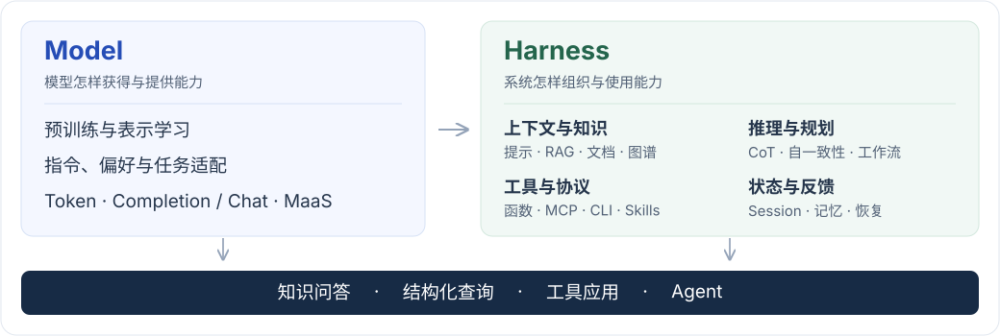
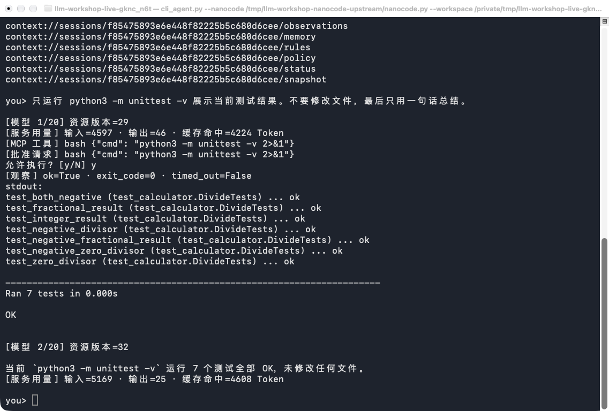

<div align="center">

# 动手学习大模型系统

从模型原理，到知识应用与 Agent 实战。

[模型基础](#模型基础) · [数据与适配](#数据与适配) · [知识与推理](#知识与推理) · [Agent 与 Harness](#agent-与-harness) · [快速开始](#快速开始) · [参考阅读](#参考阅读)

</div>

模型提供理解与生成能力，检索、工具、状态和反馈将这些能力组织成可以执行的任务。这里从模型原理与数据出发，通过中文讲解、实现代码和对照实验，逐步构建知识应用与 Agent。

<a id="选择学习入口"></a>

## 学习地图

<picture>
  <source media="(max-width: 600px)" srcset="images/learning-map-mobile.svg">
  
</picture>

从[模型接口与 Session](chapter4/model_service/README.md)理解一次请求，再进入[文档问答](chapter6/vector_qa/README.md)、[工具循环](chapter8/manual_tool_loop/README.md)和[Agent Harness](chapter9/mcp_harness/README.md)。研究模型怎样学习，则从[冻结表示与分类头](chapter3/README.md)进入[指令与偏好数据](chapter5/README.md)。

模型基础与系统机制的原理见[配套专栏](#配套专栏)和[参考阅读](#参考阅读)，各主题的实践与代码在[完整索引](#练习索引)中可以直接打开。

<a id="开始一个实践"></a>
<a id="系统实践"></a>

## 动手构建

### 有出处的文档问答

给自己的资料建立索引，让答案引用原文；当资料没有提供信息时，检查模型能否识别证据缺口。用固定题集比较召回、重排和生成，找到第一次丢失依据的环节。

[建立向量问答](chapter6/vector_qa/README.md) · [换入自己的文档](chapter6/vector_qa/README.md#从教学语料到自己的文档) · [检索与重排](chapter6/reranking/README.md) · [作为 MCP 工具接入](chapter9/rag_mcp/README.md)

### 接入飞书，让工具进入工作流

从扫码授权、搜索文档开始，将可独立运行的脚本封装成 Skill。用同一账号和关键词比较 CLI 与远程 MCP，再观察 SDK 加载技能后怎样读取和使用资料。

[扫码搜索文档](chapter9/cli_skills/README.md) · [远程 MCP](chapter9/feishu_mcp/README.md) · [Pi SDK 与技能加载](chapter9/pi_skills/README.md)

### 实现一个编程 Agent

让模型读取项目、运行测试、修改代码并再次验证。把上下文、工具权限、任务状态和循环控制拆开，观察 **Agent = Model + Harness** 如何落到实现中。

[MCP Agent Loop](chapter9/mcp_harness/README.md) · [模型与运行策略对照](chapter9/mcp_harness/README.md#model-harness-comparison) · [记忆与恢复](chapter8/filesystem_memory/README.md)



*示例编程任务的一次运行：工具执行、代码修改与测试结果可以沿同一条轨迹查看。*

### 从标注数据到训练候选

将同一批文本构造成指令样本，转换数据格式，再为同一提示生成候选回答、复核偏好。沿记录追溯原始输入、标签与来源，理解格式有效和内容可用之间的区别。

[串联数据构造](chapter5/README.md#串联数据构造实践) · [Self-Instruct](chapter5/self_instruct/README.md) · [冻结表示与分类头训练](chapter3/frozen_classifier/README.md)

<a id="开始学习"></a>
<a id="环境准备"></a>

## 快速开始

模型调用示例使用 Python 3.11 或 3.12，以及兼容 OpenAI Chat Completions 的服务。从仓库根目录运行；其他练习的额外依赖和授权步骤见对应说明：

```bash
git clone https://github.com/tylerelyt/llm-sys-workshop.git
cd llm-sys-workshop
python3.12 -m venv .venv
source .venv/bin/activate
python -m pip install 'openai>=2,<3'
cp .env.example .env
```

在 `.env` 中启用以下配置，填写服务地址、模型 ID 和密钥：

```dotenv
OPENAI_BASE_URL=https://api.example.com/v1
OPENAI_MODEL=your-model-id
OPENAI_API_KEY=your-api-key
```

运行第一次实验：

```bash
python chapter4/model_service/maas_session.py
```

程序记录一个工单号，再分别发起不带历史和携带历史的请求。打开两次请求的消息，找到工单号来自哪里，解释为什么同一个模型会给出不同回答。

接着进入[模型接口、Token 与 Session](chapter4/model_service/README.md)，理解 MaaS 怎样提供生成能力、Completion 与 Chat 怎样组织输入，以及无状态模型怎样由应用维护会话。[环境配置](README-DEEPSEEK.md#setup)说明其他模型服务和各类依赖的配置方式。

## 练习索引

实践说明包含依赖、运行命令与动手修改方式；代码链接直接进入主要实现。

### 模型基础

理解表示学习、预训练与生成接口，区分模型参数、请求中的信息和应用维护的状态。原理与阅读入口：[模型的学习机制](chapter3/README.md) · [语言模型与服务](chapter4/README.md)。

| 实践 | 重点 | 代码 |
| --- | --- | --- |
| [标记化、模型服务与无状态推理](chapter4/model_service/README.md) | Token、接口消息、输出预算与 Session | [源码](chapter4/model_service/maas_session.py) |
| [冻结嵌入与线性分类](chapter3/frozen_classifier/README.md) | 冻结表示、分类头权重与留出集结果 | [源码](chapter3/frozen_classifier/dashscope_lr_sentiment.py) |

### 数据与适配

构造、转换和复核任务数据，理解指令、示例与偏好怎样表达任务要求。主题入口：[后训练与数据](chapter5/README.md)。

| 实践 | 重点 | 代码 |
| --- | --- | --- |
| [Few-shot 指令数据](chapter5/fewshot_data/README.md) | 原始输入、配对示例与目标标签 | [源码](chapter5/fewshot_data/construct_fewshot.py) |
| [Self-Instruct 数据](chapter5/self_instruct/README.md) | 种子扩展、实例生成与过滤决定 | [源码](chapter5/self_instruct/self_instruct_workshop.py) |
| [Alpaca 数据格式](chapter5/alpaca_data/README.md) | 指令、输入和答案的字段转换 | [源码](chapter5/alpaca_data/alpaca_constructor.py) |
| [偏好数据](chapter5/preference_data/README.md) | 同一提示的候选回答、来源与人工排序 | [源码](chapter5/preference_data/rlhf_constructor.py) |

### 知识与推理

把外部资料组织进上下文，再研究多步求解、结构化查询与搜索。主题入口：[提示与知识](chapter6/README.md) · [推理方法](chapter7/README.md)。

| 实践 | 重点 | 代码 |
| --- | --- | --- |
| [基础提示方法](chapter6/basic_prompting/README.md) | 任务说明和示例怎样改变回答 | [源码](chapter6/basic_prompting/example1.py) |
| [轻量向量检索问答](chapter6/vector_qa/README.md) | 原文、向量召回、引用与固定题集 | [源码](chapter6/vector_qa/vector_qa.py) |
| [检索与重排](chapter6/reranking/README.md) | 召回候选与重排后的入选证据 | [源码](chapter6/reranking/rag_pipeline.py) |
| [知识图谱构建](chapter6/knowledge_graph/README.md) | 实体、别名合并与关系出处 | [源码](chapter6/knowledge_graph/knowledge_pipeline.py) |
| [企业 NL2SQL](chapter6/nl2sql/README.md) | 表结构、只读 SQL 与实际查询结果 | [源码](chapter6/nl2sql/nl2sql_engine.py) |
| [语义去重](chapter6/semantic_dedup/README.md) | 重复片段、版本冲突与来源保留 | [源码](chapter6/semantic_dedup/lab.py) |
| [切块质量反馈](chapter6/chunk_feedback/README.md) | 回答反馈与片段证据的区别 | [源码](chapter6/chunk_feedback/lab.py) |
| [跨语言检索](chapter6/cross_language/README.md) | 译文限制与跨语种召回 | [源码](chapter6/cross_language/lab.py) |
| [迭代图检索](chapter6/graph_search/README.md) | 实际访问的关系与完整证据链 | [源码](chapter6/graph_search/lab.py) |
| [多模态图像分析](chapter6/image_context/README.md) | 原图与 OCR 保留的信息 | [源码](chapter6/image_context/image_analyzer.py) |
| [文档提取与问答](chapter6/document_qa/README.md) | 读取范围、页码与原文依据 | [源码](chapter6/document_qa/document_processing.py) |
| [法律文书分析](chapter6/legal_qa/README.md) | 条款冲突、原文更新与未知信息 | [源码](chapter6/legal_qa/document_qa.py) |
| [CoT 与推理编排](chapter7/cot_workflows/README.md) | 多步求解、任务交接与约束保留 | [源码](chapter7/cot_workflows/example1.py) |
| [自一致性](chapter7/self_consistency/README.md) | 多次采样、投票、错误与弃权 | [源码](chapter7/self_consistency/example1.py) |

### Agent 与 Harness

从一次工具调用，深入到会话、记忆、协议与持续执行。主题入口：[语言智能体](chapter8/README.md) · [认知架构与系统组织](chapter9/README.md)。

#### 工具、执行与记忆

| 实践 | 重点 | 代码 |
| --- | --- | --- |
| [手写函数调用](chapter8/manual_tool_loop/README.md) | 模型动作、参数处理与实际函数执行 | [源码](chapter8/manual_tool_loop/function_call_workshop.py) |
| [框架工具调用](chapter8/autogen_tool_loop/README.md) | 同一任务在框架中的执行与停止 | [源码](chapter8/autogen_tool_loop/autogen_function_call_demo.py) |
| [ReAct Agent](chapter8/react_agent/README.md) | 动作、环境观察与后续决策 | [源码](chapter8/react_agent/example1.py) |
| [计算工具 Agent](chapter8/calculator_agent/README.md) | 计算参数、工具结果与独立复算 | [源码](chapter8/calculator_agent/calculator_agent.py) |
| [天气工具 Agent](chapter8/weather_agent/README.md) | 地点到天气查询的数据传递 | [源码](chapter8/weather_agent/multimodal_chat.py) |
| [对话历史管理](chapter8/conversation_memory/README.md) | 窗口裁剪、事实摘要与当前输入 | [源码](chapter8/conversation_memory/example1.py) |
| [持久记忆](chapter8/persistent_memory/README.md) | 记忆写入与新进程加载 | [源码](chapter8/persistent_memory/memgpt_integration_demo.py) |
| [文件系统上下文与外部记忆](chapter8/filesystem_memory/README.md) | 文件中的完整观察与恢复上下文 | [源码](chapter8/filesystem_memory/filesystem_memory_demo.py) |
| [代码转换与行为校验](chapter8/code_translation/README.md) | 转换后代码的真实运行行为 | [源码](chapter8/code_translation/code_translation.py) |
| [代码解释器](chapter8/code_interpreter/README.md) | 生成、执行与独立结果校验 | [源码](chapter8/code_interpreter/code_interpreter_workshop.py) |

#### 上下文、控制与接入

| 实践 | 重点 | 代码 |
| --- | --- | --- |
| [顺序工作流](chapter9/sequential_planning/README.md) | 阶段产物与原始约束 | [源码](chapter9/sequential_planning/sequential_workflow.py) |
| [面向缓存的提示设计](chapter9/prefix_cache/README.md) | 稳定前缀与服务报告的缓存用量 | [源码](chapter9/prefix_cache/example.py) |
| [工具遮罩与动态行为控制](chapter9/tool_masking/README.md) | 状态规则和执行入口的权限守卫 | [源码](chapter9/tool_masking/tool_masking_demo.py) |
| [目标复述与任务管理](chapter9/task_recitation/README.md) | 任务状态与下一轮目标提醒 | [源码](chapter9/task_recitation/attention_recitation_demo.py) |
| [错误保留与失败学习](chapter9/error_recovery/README.md) | 失败轨迹、恢复与重试预算 | [源码](chapter9/error_recovery/adaptive_retry.py) |
| [反思与改进](chapter9/reflection/README.md) | 评审依据、改写与可复用经验 | [源码](chapter9/reflection/reflection_system_demo.py) |
| [MCP 工具发现与调用](chapter9/mcp_tools/README.md) | 工具发现、参数结构与真实调用 | [源码](chapter9/mcp_tools/mcp_harness.py) |
| [飞书远程 MCP](chapter9/feishu_mcp/README.md) | 用户凭证、权限与远程文档搜索 | [源码](chapter9/feishu_mcp/remote_feishu_mcp.py) |
| [CLI Skill 与扫码授权](chapter9/cli_skills/README.md) | 扫码授权、命令复用与技能封装 | [源码](chapter9/cli_skills/skills/feishu-document-search/scripts/search_documents.py) |
| [Pi SDK 与技能加载](chapter9/pi_skills/README.md) | SDK 会话和技能加载前后的行为 | [源码](chapter9/pi_skills/pi_probe.mjs) |
| [检索服务接入 Harness](chapter9/rag_mcp/README.md) | 工具返回的原文、版本与最终引用 | [源码](chapter9/rag_mcp/server.py) |
| [用 MCP 实现 Agent Loop 与 Harness](chapter9/mcp_harness/README.md) | 上下文组装、工具执行、观察写回与循环接续 | [客户端](chapter9/mcp_harness/cli_agent.py) · [服务端](chapter9/mcp_harness/context_server.py) |

<a id="按问题查找"></a>

<details>
<summary>遇到问题时，从相关实验继续查找</summary>

| 遇到的问题 | 相关实验 |
| --- | --- |
| 回答缺少依据，或检索到了错误资料 | [检索问题定位](chapter6/README.md) · [召回与重排](chapter6/reranking/README.md) · [固定题集比较](chapter6/vector_qa/README.md#用一组问题判断系统表现) |
| 工具看似执行了，结果却不对 | [参数与结果传递](chapter8/manual_tool_loop/README.md) · [代码转换与行为校验](chapter8/code_translation/README.md) |
| 对话太长丢失事实，重启后无法接续 | [窗口与摘要](chapter8/conversation_memory/README.md) · [持久记忆](chapter8/persistent_memory/README.md) · [文件系统记忆](chapter8/filesystem_memory/README.md) |
| 想减少重复输入或控制任务开销 | [提示前缀与缓存用量](chapter9/prefix_cache/README.md) · [采样次数与正确性](chapter7/self_consistency/README.md) |
| Agent 越权、偏离目标或反复重试 | [工具许可](chapter9/tool_masking/README.md) · [任务管理](chapter9/task_recitation/README.md) · [失败与恢复](chapter9/error_recovery/README.md) |
| 生成数据格式正确，内容却不可用 | [过滤与人工复核](chapter5/self_instruct/README.md) · [候选偏好排序](chapter5/preference_data/README.md) |

</details>

## 配套专栏

| 专栏 | 内容 |
| --- | --- |
| [大模型系统实战](https://time.geekbang.org/column/intro/100613101) | 模型基础、系统架构与工程实践 |
| [前沿模型实战课](https://time.geekbang.org/column/intro/100828301) | 模型调用、推理、检索增强与智能体应用 |

[技术概述](chapter1/README.md)与[产业背景](chapter2/README.md)通过专栏阅读。学习具体方法时，可以对照实验中的输入、实现和结果，再回到原理深入理解。

## 参考阅读

结合实践阅读原始论文和工程文章，理解方法的假设与适用范围。各主题的阅读说明给出关注点，便于从实验回到原理。

- **模型原理**：[Attention Is All You Need](https://arxiv.org/abs/1706.03762)。继续阅读[预训练与迁移](chapter3/README.md#参考阅读)、[语言模型与推理服务](chapter4/README.md#参考阅读)。
- **数据与后训练**：[Self-Instruct](https://arxiv.org/abs/2212.10560)、[通过人类反馈训练语言模型遵循指令](https://arxiv.org/abs/2203.02155)。更多见[后训练阅读](chapter5/README.md#参考阅读)。
- **检索增强**：[RAG 原始论文](https://arxiv.org/abs/2005.11401)。更多见[检索、图谱与文档处理](chapter6/README.md#参考阅读)。
- **推理方法**：[CoT](https://arxiv.org/abs/2201.11903)、[Self-Consistency](https://arxiv.org/abs/2203.11171)。更多见[推理与搜索](chapter7/README.md#参考阅读)。
- **工具与记忆**：[ReAct](https://arxiv.org/abs/2210.03629)、[MemGPT](https://arxiv.org/abs/2310.08560)。更多见[智能体构建](chapter8/README.md#参考阅读)。
- **Harness 与上下文工程**：[构建 Manus 的上下文工程经验](https://manus.im/blog/Context-Engineering-for-AI-Agents-Lessons-from-Building-Manus)。更多见[认知架构与交互协议](chapter9/README.md#参考阅读)。

## 一起动手

欢迎分享你的实现、问题和踩坑经历。修复一个 Bug、补充一个实验、讲清一个概念，或提出一种不同的做法，都能让这个项目变得更有用。

遇到问题可以开 Issue，附上运行命令、环境和去除密钥后的错误信息。试出新方法可以提 PR，带上代码、运行方式和你观察到的结果，让更多人复现、讨论和继续改进。

[问题与建议](https://github.com/tylerelyt/llm-sys-workshop/issues) · [贡献代码](https://github.com/tylerelyt/llm-sys-workshop/pulls) · [贡献者](https://github.com/tylerelyt/llm-sys-workshop/graphs/contributors) · [MIT 许可证](LICENSE)
