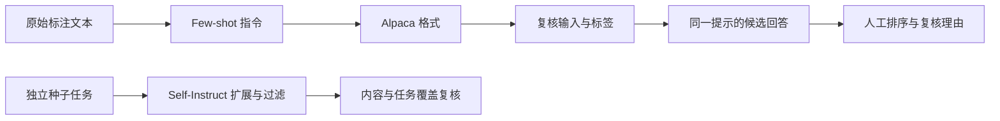

# LLM 基础

理解预训练与后训练的分工，学习怎样把任务要求表达为可复核的数据。

先结合专栏学习缩放定律、预训练资源、指令微调与偏好对齐。下面的数据实验分别处理示例组织、任务扩展、格式转换和答案排序；这些结果还需要内容复核，才能作为训练候选。

## 从任务定义到数据复核

| 练习 | 要解决的问题 |
| --- | --- |
| [Few-shot 指令数据](fewshot_data/README.md) | 原始输入、任务说明、示例与目标标签是否保持一致？ |
| [Self-Instruct](self_instruct/README.md) | 自动扩展的任务是否有覆盖，过滤后是否仍有错误答案？ |
| [Alpaca 数据格式](alpaca_data/README.md) | 格式转换是否完整保留了输入条件与目标输出？ |
| [偏好数据](preference_data/README.md) | 候选答案为什么有优劣，复核者是否使用一致标准？ |

各练习可以独立运行。下面沿同一批记录串联已有接口；换入自己的业务数据时，按各脚本的输入格式适配。

## 串联数据构造实践

用同一批情感标注数据观察记录怎样变化。Few-shot 的输出可直接进入 Alpaca 转换，复核后的 Alpaca 记录再用于生成候选偏好对；Self-Instruct 使用独立种子文件扩展任务。



从仓库根目录安装本条路径的依赖，并创建独立输出目录。前两步只做本地数据转换：

```bash
python -m pip install \
  -r chapter5/fewshot_data/requirements.txt \
  -r chapter5/alpaca_data/requirements.txt \
  -r chapter5/preference_data/requirements.txt
DATA_RUN=$(mktemp -d)
python chapter5/fewshot_data/construct_fewshot.py \
  --input-file chapter5/fewshot_data/data/sentiment_demo.json \
  --task-type sentiment --seed 42 \
  --output-path "$DATA_RUN/fewshot.jsonl"
python chapter5/alpaca_data/alpaca_constructor.py \
  --input-file "$DATA_RUN/fewshot.jsonl" \
  --conversion-type fewshot_to_alpaca \
  --output-path "$DATA_RUN/alpaca.jsonl"
```

打开同一条记录的三个版本，核对原始目标文本与标签。Few-shot 的 `instruction` 包含示例和目标，Alpaca 的 `input` 应保留目标文本。本例先将原始标签 `0/1` 映射为“负面/正面”，随后转换应保持 `output` 不变；转换不应把示例答案移到目标输入中。复核完成后继续使用同一个终端和 `DATA_RUN`。

按[模型配置](../README-DEEPSEEK.md#setup)设置 `OPENAI_BASE_URL` 和 `OPENAI_API_KEY`。将下面两个占位值替换为同一服务真实可用的模型 ID，再为前面的记录生成候选回答：

```bash
MODEL_A='your-model-a-id'
MODEL_B='your-model-b-id'
python chapter5/preference_data/rlhf_constructor.py \
  --input-file "$DATA_RUN/alpaca.jsonl" --max-samples 3 \
  --method model_comparison --provider openai \
  --high-model "$MODEL_A" --low-model "$MODEL_B" \
  --output-path "$DATA_RUN/preferences.jsonl"
```

`--high-model` 与 `--low-model` 只是脚本的两个初始槽位，不代表实际质量排序。先隐藏来源，按目标标签与任务要求复核两个回答，再决定保留、交换或标记平局；原始文件与人工复核版本分开保存。回答完全相同时脚本跳过该对，没有候选对时会报错。

| 文件 | 来自哪里 | 需要核对什么 |
| --- | --- | --- |
| `fewshot.jsonl` | 原始标注文本 | 示例与目标分开，目标文本与标签对应 |
| `alpaca.jsonl` | Few-shot 输出 | 指令、目标输入、答案的转换是否保真 |
| `preferences.jsonl` | Alpaca 的同一任务提示 | 原目标答案未进入提示，候选来源保留，排序经过人工复核 |

Self-Instruct 独立运行，不接在 Few-shot 文件后面。它需要自己的依赖和种子任务；生成结果与过滤原因分别保留：

```bash
python -m pip install -r chapter5/self_instruct/requirements.txt
SELF_INSTRUCT_OUTPUT="$DATA_RUN/self-instruct" \
  python chapter5/self_instruct/self_instruct_workshop.py
```

批次、随机种子、生成配置与来源模型随数据保存。将同一套检查用于自己的任务，先解决标签和覆盖问题，再比较增加样本或更换模型带来的变化；最终测试问题与构造数据分开。

## 连接训练与应用

从自己的任务中选出正常、边界与无法完成的例子，检查生成数据是否覆盖它们。将用于开发和选择方案的样本与最终测试问题分开，防止把效果判断建立在重复见过的数据上。

用[冻结表示与分类头](../chapter3/frozen_classifier/README.md)观察实际参数更新；用[基础提示](../chapter6/basic_prompting/README.md)观察把示例放入上下文时的行为。分别说明训练数据、评估数据与运行时示例的用途。

## 参考阅读

- [Self-Instruct：用自生成指令对齐语言模型](https://arxiv.org/abs/2212.10560)：对照种子、任务扩展、实例生成和过滤，检查自动构造数据的假设。
- [Stanford Alpaca 项目](https://github.com/tatsu-lab/stanford_alpaca)：了解指令数据的组织方式，与格式转换实验逐字段对照。
- [通过人类反馈训练语言模型遵循指令](https://arxiv.org/abs/2203.02155)：理解示范数据、偏好比较、奖励模型和策略优化的关系。
- [Constitutional AI：通过 AI 反馈实现无害性](https://arxiv.org/abs/2212.08073)：研究原则引导的修订与 AI 反馈，并检查反馈来源对数据的影响。
- [LoRA：大语言模型的低秩适配](https://arxiv.org/abs/2106.09685)与[QLoRA：量化模型的高效微调](https://arxiv.org/abs/2305.14314)：结合专栏理解后训练的参数与资源开销；数据实验帮助准备和复核训练候选。

[学习地图](../README.md#学习地图) · [模型配置](../README-DEEPSEEK.md#setup)
