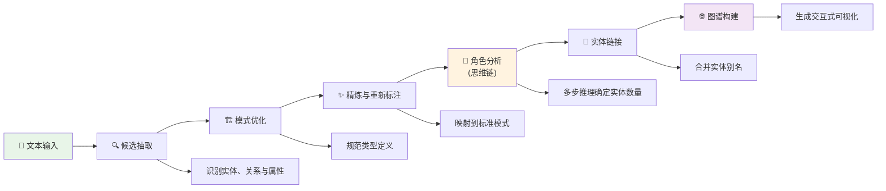

<a id="lesson-2-knowledge-graph-construction-with-chain-of-thought-reasoning"></a>

# 知识图谱构建

本课实现端到端知识图谱构建流水线，使用大语言模型和思维链（CoT）推理，从非结构化文本中解析实体并抽取关系。

先用原始教学文本运行完整五阶段，记录“蒂姆·库克”与“库克先生”在 `pre_linking_graph_state`、`post_linking_graph_state` 中的变化。学员要能指出支持合并的句子，并证明合并后“宣布产品”等关系仍指向正确对象。

只修改 `data/sample_text.txt`，追加“工程师库克负责芯片测试，与 CEO 蒂姆·库克不是同一人。”保持模型、提示与类型定义不变再运行，预测同名工程师会不会被误合并。核对本轮日志中的候选实体、角色数量、`alias_map` 与最终三元组，确认两个角色各有原文依据，不能仅凭图上节点减少就判断改善。

每轮结束后把本课 `results/` 复制到自己命名的对照目录。程序会更新固定文件名的图谱，日志按时间命名；先按终端显示的本轮日志定位结果，再打开对应 JSON 与 HTML。恢复输入文件中的追加句即可复跑原始样例。本练习需要在线模型完成抽取，本地结构检查只核对返回数据如何进入图谱。调用失败时程序以非零状态结束，旧图谱只能作为上一轮记录。

---

> **所属章节**：提示工程方法· 提示工程方法
> **学习基础**：完成检索与重排练习，了解图论
> **建议时长**：60—90 分钟
> **难度**：进阶

## 工程任务

同一个实体有多个名字，模型抽出的关系可能重复或相互冲突。

在 [knowledge_pipeline.py](knowledge_pipeline.py) 中，固定文本和模型，只改变一条别名归并规则。

逐条回到原文核对归并与三元组，说明节点减少是否真的改善了图谱。

## 学习目标

<a id="technical-learning-outcomes"></a>

### 需要掌握的技术能力

- **信息抽取**：使用结构化提示词抽取实体、关系与属性
- **本体工程**：实现模式自动优化与规范化算法
- **思维链推理**：通过多步逻辑分析改善抽取精度
- **实体解析**：结合上下文实现实体链接与共指消解
- **图谱分析**：使用 NetworkX 和 Pyvis 生成交互式知识图谱

<a id="-technical-architecture-overview"></a>

## 📋 技术架构概览

<a id="1-system-architecture"></a>

### 1. 系统架构



<a id="2-core-algorithms"></a>

### 2. 核心算法

- **实体、关系与属性分离**：准确区分三类概念
- **思维链推理**：通过多步逻辑分析改善准确性
- **结合上下文的链接**：依据语义理解合并实体

<a id="3-case-studies"></a>

### 3. 案例研究

- 📝 分析**中文企业文档**
- 🏗️ 演示**五阶段流水线**
- 🌐 生成**交互式可视化**

<a id="run-the-graph-pipeline"></a>

## 运行图谱构建流水线

为所选 Chat Completions 服务导出 `OPENAI_BASE_URL`、`OPENAI_MODEL` 和 `OPENAI_API_KEY`。本脚本从 `LLM_MODEL` 读取模型 ID。以下命令在仓库根目录运行。[模型配置](../../README-DEEPSEEK.md)

```bash
python -m pip install -r chapter6/knowledge_graph/requirements.txt
export LLM_MODEL="$OPENAI_MODEL"
env -u DASHSCOPE_API_KEY python chapter6/knowledge_graph/knowledge_pipeline.py
```

上述命令为本次进程选择兼容 OpenAI 的调用路径。选用 DashScope 时，导出 `DASHSCOPE_API_KEY`，将 `LLM_MODEL` 设为该服务可用的模型，然后直接运行脚本。

默认教学输入保存在 `chapter6/knowledge_graph/data/sample_text.txt`。生成的图谱、JSON 和日志保存在本课 `results/` 目录，运行位置不会改变这些路径。

```text
chapter6/knowledge_graph/
├── data/
│   └── sample_text.txt
└── results/
    ├── knowledge_graph.html
    ├── knowledge_graph.json
    └── pipeline_log_*.log
```

记录一个实体在别名合并前后的变化，指出支持合并的具体句子，再核对它的关系是否仍连接到正确对象。

<a id="-technical-deep-dive"></a>

## 💡 技术详解

<a id="1-five-stage-pipeline"></a>

### 1. 五阶段流水线

<a id="step-1-candidate-extraction"></a>

#### 第一步 · 候选抽取

```python
# Use structured prompts to extract entities, relations, and attributes
entities, relations = extractor.extract_candidates(text)
```
- 🎯 **目标**：识别文本中可能构成知识的元素
- 🔧 **方法**：基于少样本示例的结构化抽取
- 📊 **输出**：候选实体列表与关系三元组

<a id="step-2-schema-optimization"></a>

#### 第二步 · 模式优化

```python
# Normalize entity types, relation types, and attribute types
optimized_schema = extractor.optimize_ontology(entities, relations)
```
- 🎯 **目标**：统一并规范知识图谱模式
- 🔧 **方法**：类型合并与语义聚类
- 📊 **输出**：规范化的类型定义

<a id="step-3-refinement--relabeling"></a>

#### 第三步 · 精炼与重新标注

```python
# Relabel candidate triples according to optimized schema
refined_triples = extractor.refine_and_relabel(relations, optimized_schema)
```
- 🎯 **目标**：将候选关系映射到标准模式
- 🔧 **方法**：语义匹配与类型映射
- 📊 **输出**：符合模式约定的精炼三元组

<a id="step-4-role-analysis-with-chain-of-thought"></a>

#### 第四步 · 用思维链分析角色

```python
# Use Chain-of-Thought analysis to determine entity counts
role_analysis = extractor.analyze_roles(text)
```
- 🎯 **目标**：判断文本中独立实体的实际数量
- 🔧 **方法**：**思维链推理**
- 📊 **输出**：每种角色类型的实体数量

<a id="step-5-context-aware-entity-linking"></a>

#### 第五步 · 结合上下文进行实体链接

```python
# Perform intelligent entity merging based on role analysis results
alias_map = extractor.link_entities(list(entities), role_analysis)
```
- 🎯 **目标**：合并指向同一实体的不同表达
- 🔧 **方法**：结合上下文识别别名
- 📊 **输出**：实体别名映射表

<a id="2-chain-of-thought-advantages"></a>

### 2. 思维链的作用

<a id="traditional-approach-vs-cot-method"></a>

#### 直接抽取与思维链方法的对照

```python
# Traditional approach: Direct extraction
entities = ["Apple Inc.", "CEO", "Tim Cook", "Mr. Cook"]
# CoT approach: Step-by-step reasoning
reasoning = """
1. Identify role types: Company(1), Person(1)
2. Analyze coreference relations:
   - "Tim Cook" = Proper name, core identifier
   - "Mr. Cook" = Respectful reference to same person
   - "CEO" = Position description, not independent entity
3. Conclusion: Should merge into one person entity
"""
final_entities = ["Apple Inc.", "Tim Cook"]  # Significantly improved accuracy
```

<a id="3-knowledge-graph-quality-assessment"></a>

### 3. 知识图谱质量评估

<a id="automated-quality-metrics"></a>

#### 自动化质量指标

```python
quality = kg.assess_quality()
# Read structural diagnostics returned by the current implementation.
print(quality["total_nodes"], quality["total_edges"])
print(quality["issues"], quality["warnings"], quality["stats"])
```

<a id="-practical-case-study"></a>

## 📊 实践案例

<a id="sample-input-text"></a>

### 输入文本示例

在下面的教学示例中，逐句核对别名与关系。
```
Apple Inc.'s CEO Tim Cook announced the new iPhone 15 product yesterday at the California headquarters.
This revolutionary smartphone features the advanced A17 chip with excellent performance and outstanding camera capabilities.
Mr. Cook was very satisfied with this launch event, stating it's one of the most important products in Apple's history.
```

<a id="extraction-results"></a>

### 抽取结果

```python
# Final knowledge graph
entities = [
    {"name": "Tim Cook", "type": "Person", "attributes": {"position": "CEO", "emotion": "satisfied"}},
    {"name": "Apple Inc.", "type": "Organization", "attributes": {"headquarters": "California"}},
    {"name": "iPhone 15", "type": "Product", "attributes": {"chip": "A17", "feature": "revolutionary"}}
]

relations = [
    {"subject": "Tim Cook", "predicate": "serves_as_CEO", "object": "Apple Inc."},
    {"subject": "Apple Inc.", "predicate": "released", "object": "iPhone 15"},
    {"subject": "Tim Cook", "predicate": "announced", "object": "iPhone 15"}
]
```

<a id="visualization-features"></a>

### 可视化功能

- 🎨 **交互节点**：拖动、缩放，悬停查看详情
- 🏷️ **关系标签**：用清晰的边标签显示关系类型
- 🎯 **属性展示**：悬停查看实体属性
- 📐 **自动布局**：基于物理模拟组织图谱布局

<a id="-key-learning-points--technical-focus"></a>

## 🔍 学习重点与技术要点

<a id="1-understanding-entity-relation-attribute-separation"></a>

### 1. 理解实体、关系与属性的分离

```python
# ✅ Correct classification
Entity: "John Smith"      # Independent object
Relation: "works_at"      # Action/connection between entities
Attribute: "experienced"  # Characteristic/property of entity
# ❌ Common mistakes
Entity: "experienced John Smith"  # Should split into Entity + Attribute
Relation: "John is diligent"      # "diligent" is attribute not relation
```

<a id="2-mastering-chain-of-thought-reasoning-pattern"></a>

### 2. 掌握思维链推理模式

```python
# CoT reasoning template
"""
1. [Text Understanding]: Identify text theme and scenario
2. [Role Identification]: Determine involved role types
3. [Instance Analysis]: Analyze specific instances under each role type
4. [Identity Judgment]: Identify different expressions referring to same object
5. [Count Conclusion]: Determine number of independent entities for each role
"""
```

<a id="3-core-entity-linking-strategies"></a>

### 3. 实体链接的核心策略

- **专有名称优先**：优先使用人名、地名等作为标识
- **上下文一致性**：分析表达之间的语义联系
- **修饰语处理**：形容词通常不会产生新实体
- **数量约束**：依据思维链分析得到的实体数量限定合并范围

<a id="-customization--extension"></a>

## 🛠️ 定制与扩展

<a id="1-replace-input-text"></a>

### 1. 替换输入文本

```python
# Edit chapter6/knowledge_graph/data/sample_text.txt before rerunning the pipeline.
text_content = "Your domain-specific text..."
```

<a id="2-custom-entity-types"></a>

### 2. 定制实体类型

```python
# Specify domain-specific types during Schema optimization
domain_entities = ["Person", "Organization", "Technology", "Event"]
domain_relations = ["develops", "participates_in", "located_at"]
```

<a id="3-adjust-model-parameters"></a>

### 3. 调整模型参数

```python
# Choose different LLM models
LLM_MODEL = "your-provider-model-id"
# Adjust reasoning temperature
temperature = 0.1    # More conservative output
```

<a id="-further-reading--reference"></a>

## 📚 延伸阅读与参考

- [BAAI/bge-m3 模型资料](https://huggingface.co/BAAI/bge-m3)
- [LangChain 知识图谱构建资料](https://python.langchain.com/docs/use_cases/graph/)
- [NetworkX 库](https://networkx.org/)
- [Pyvis 可视化文档](https://pyvis.readthedocs.io/en/latest/)

<a id="-technical-competency-self-assessment"></a>

## 🎓 技术能力自查

<a id="acquired-skills"></a>

### 应掌握的技能

1. **端到端知识图谱构建**：从原始文本生成交互式图谱
2. **思维链推理**：改善信息抽取与实体解析
3. **本体工程**：自动优化和规范化模式
4. **图数据建模**：使用实体、关系和属性组织信息
5. **图谱可视化**：生成交互式网络图

<a id="next-learning-steps"></a>

### 后续学习方向

- **NL2SQL 练习**：构建企业查询系统
- **进阶主题**：接入外部知识库，丰富图谱
- **研究方向**：探索多模态知识图谱构建

---

<a id="next-steps"></a>

## 后续学习

## 在自己的项目中使用

从自己的文档选一组同名实体、别名与版本冲突，先手工标出支持关系的句子，再检查自动抽取与合并。只有回答确实需要跨关系追踪时，再参考[图检索](../graph_search/README.md)设计查询和停止条件。

[主题目录](../README.md) · [课程首页](../../README.md)
