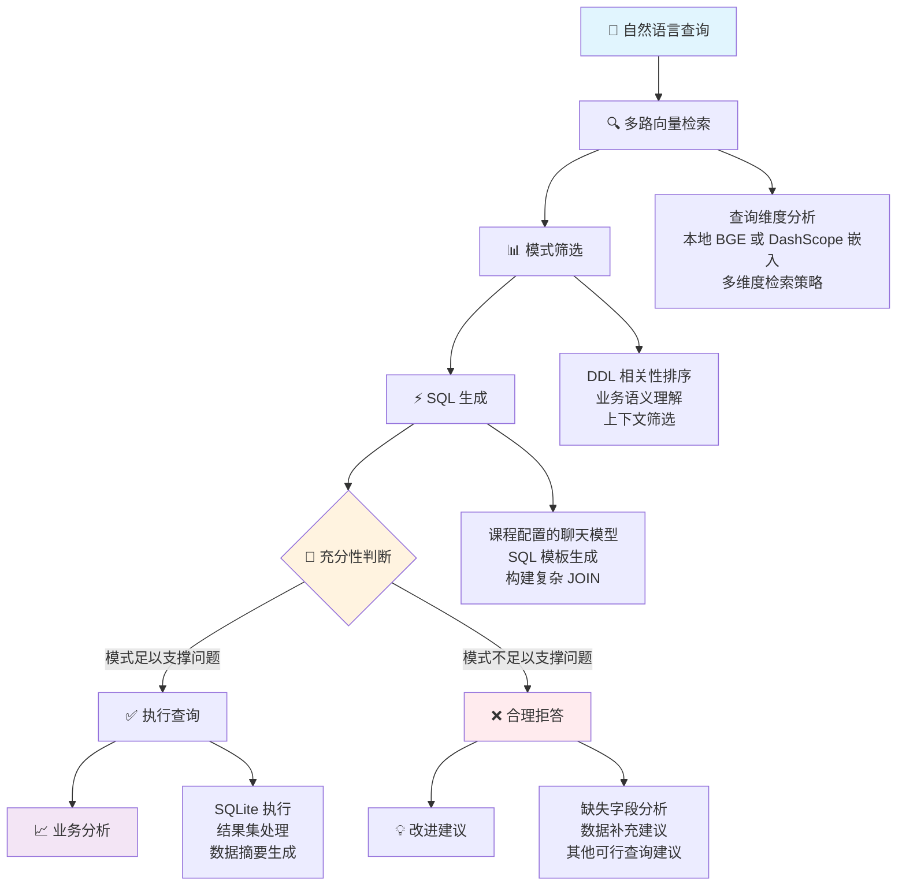

<a id="lesson-3-enterprise-grade-nl2sql-system"></a>

# 企业 NL2SQL

使用包含十张表的教学数据库，将中文问题转成 SQL。对照检索到的模式、生成的查询、执行结果，以及数据不足以回答问题时的说明。

先用已有 `orders` 表回答“订单总数是多少？”，再只把问题改成“客户满意度与投诉率有什么关系？”。前者应实际执行只读 SQL，并可与本地 `SELECT COUNT(*) FROM orders` 对照；后者需要当前模式没有的满意度和投诉记录，应返回缺失依据，且不执行查询。学员负责检查 DDL 与 SQL 是否对应业务含义。

按下方配置完成环境后，从仓库根目录运行独立对照，`--question` 可重复传入，省略时仍运行原有两道复杂场景题：

```bash
python chapter6/nl2sql/nl2sql_engine.py \
  --question '订单总数是多少？' \
  --question '客户满意度与投诉率有什么关系？'
```

在程序的本地结果中核对订单数量，在日志中核对每题的 `relevant_schemas`、生成 SQL、返回行与 `schema_insufficient`。拒答题应没有 SQL 和结果行，不能把执行错误当作合理拒答。只改问题，保留模式约束与数据库的只读执行路径。更深入时再单独调整 `NL2SQLPipeline.ask` 中的 `top_k_per_path`，保持同一道题比较送入模型的 DDL。数据库使用教学数据，固定路径保存在 `CONFIG["database"]["path"]`；另设该路径可隔离自己的实验，恢复问题或候选数量即可重跑。

---

> **所属章节**：提示工程方法· 提示工程方法
> **学习基础**：完成第 1—2 课（RAG 与知识图谱），熟悉 SQL
> **建议时长**：90—120 分钟
> **难度**：深入

## 工程任务

业务人员希望直接提问数据库。模型生成的 SQL 即使能执行，也可能查错表或缺少过滤条件。

在 [nl2sql_engine.py](nl2sql_engine.py) 中，固定问题、数据库与模型，只改变 schema 召回的 top_k，保留只读守卫。

对照实际 DDL、只读守卫和数据库结果判断正确性，并说明证据不足时为什么应拒答。

## 系统架构概览

<a id="core-technical-capabilities"></a>

### 核心技术能力

- **关系数据库建模**：设计并实现包含多表关系的企业数据库模式
- **模型生成 SQL**：将 DDL 作为上下文，让语言模型生成 SQL
- **多路模式检索**：分解查询维度，从多个方向检索相关模式
- **查询有效性判断**：分析数据库模式能否支撑问题，证据不足时给出说明
- **结果抽象**：检查发送给作答模型的列类型与行数

<a id="-system-architecture-overview"></a>

## 📋 系统架构详解

<a id="1-enterprise-grade-architecture-design"></a>

### 1. 企业场景的架构设计



<a id="2-core-technology-stack"></a>

### 2. 核心技术栈

- **向量检索**：本地 BGE 嵌入，或可选的 DashScope `text-embedding-v4` 接口
- **SQL 生成**：使用 `OPENAI_MODEL` 指定的模型，或配置的 DashScope 模型
- **数据库**：SQLite 与十张企业业务核心表
- **结果摘要**：将列类型与行数发送给作答模型，需要得出数值结论时，在本地检查实际结果行

<a id="3-production-scenarios"></a>

### 3. 业务场景

- 💼 **十表企业 BI 数据库**：包含 customers、orders、employees 等表
- 🔍 **复杂多表关联**：税率分析与销售潜力评估
- 🛡️ **合理拒答机制**：数据库模式不足以支持问题时给出说明

<a id="run-the-nl2sql-pipeline"></a>

## 运行 NL2SQL 流水线

导出聊天模型所需的三个 `OPENAI_*` 变量，再按下列命令选用本地嵌入。在仓库根目录运行。[模型配置](../../README-DEEPSEEK.md)

```bash
python -m pip install -r chapter6/nl2sql/requirements.txt
export WORKSHOP_LOCAL_EMBEDDING_MODEL=BAAI/bge-small-zh-v1.5
python chapter6/nl2sql/nl2sql_engine.py
```

首次运行会下载本地 BGE 模型。选用 DashScope 嵌入时，取消 `WORKSHOP_LOCAL_EMBEDDING_MODEL`，并配置 `DASHSCOPE_API_KEY`。嵌入与聊天分别使用各自的服务配置。

脚本初始化 `CONFIG["database"]["path"]` 指定的教学数据库，并运行两个业务问题。对能够执行的查询，检查检索到的 DDL、SQL、结果数量和本地结果行。对被拒绝的问题，找出缺少的具体字段或关系。查询成功执行后，还需要核对其业务含义是否正确。

<a id="-technical-deep-dive"></a>

## 💡 技术详解

<a id="1-enterprise-database-design"></a>

### 1. 企业数据库设计

<a id="10-core-business-tables"></a>

#### 十张业务核心表

```sql
-- Customers table (customer profile and classification)
CREATE TABLE customers (
    id INTEGER PRIMARY KEY,
    name TEXT NOT NULL,
    email TEXT UNIQUE,
    phone TEXT,
    customer_type TEXT,  -- VIP, enterprise, individual customers, etc.
    registration_date TEXT,
    credit_score INTEGER,
    preferred_contact_method TEXT
);

-- Orders table (core transaction data)
CREATE TABLE orders (
    id INTEGER PRIMARY KEY,
    customer_id INTEGER NOT NULL,
    employee_id INTEGER NOT NULL,
    order_date TEXT NOT NULL,
    total_amount REAL,
    status TEXT,  -- completed, processing, cancelled, promotion, etc.
    shipping_region_id INTEGER,
    FOREIGN KEY (customer_id) REFERENCES customers (id),
    FOREIGN KEY (employee_id) REFERENCES employees (id),
    FOREIGN KEY (shipping_region_id) REFERENCES regions (id)
);

-- Regions table (including tax rates for fiscal and price sensitivity analysis)
CREATE TABLE regions (
    id INTEGER PRIMARY KEY,
    name TEXT NOT NULL UNIQUE,
    country TEXT NOT NULL,
    timezone TEXT,
    tax_rate REAL  -- Key: regional tax rates for fiscal analysis
);
```

<a id="2-multi-path-vector-retrieval-strategy"></a>

### 2. 多路向量检索策略

<a id="traditional-single-path-vs-multi-path-retrieval"></a>

#### 单路检索与多路检索的对照

```python
query = "Analyze regional tax impact on sales"
single_path = vector_store.retrieve_relevant_schemas(query, top_k=5)
# The method uses the configured model to decompose the question into dimensions,
# retrieves schemas for each dimension, and merges the results.
multi_path = vector_store.multi_path_retrieve_schemas(
    query, llm_provider, top_k_per_path=3
)
```

<a id="3-intelligent-rejection-mechanism"></a>

### 3. 合理拒答机制

<a id="schema-sufficiency-assessment"></a>

#### 数据库模式是否足以支撑问题

```python
# Intelligent assessment example
query = "Analyze customer satisfaction impact on repurchase rate"
# LLM analyzes required fields
required_fields = ["customer_satisfaction", "repurchase_rate", "customer_behavior"]
# Check existing DDL
available_fields = extract_fields_from_ddl(relevant_ddl)
# Intelligent rejection
if not all(field in available_fields for field in required_fields):
    return "SCHEMA_INSUFFICIENT: Missing customer satisfaction rating fields, analysis cannot proceed"
```

<a id="4-data-privacy-protection-mechanism"></a>

### 4. 数据隐私保护机制

<a id="data-abstraction-technology"></a>

#### 数据抽象方法

```python
def _create_data_summary(self, data: List[Dict[str, Any]]) -> str:
    """Create data summary to prevent sensitive information leakage"""
    if not data:
        return "No data available."

    # Only provide structured statistical information, no actual data values
    summary_data = {
        "total_records": len(data),
        "columns_info": {
            col: type(value).__name__
            for record in data
            for col, value in record.items()
        },
        "data_structure": "Multi-table query results with business metrics",
        "privacy_note": "Actual data values omitted for security"
    }
    return json.dumps(summary_data, indent=2, ensure_ascii=False)
```

<a id="-practical-case-studies"></a>

## 📊 实践案例

<a id="case-1-aggregation-and-the-limits-of-tax-analysis"></a>

### 案例 1 · 聚合查询与税率分析的边界

```sql
-- Illustrative aggregation over the available fields.
-- This groups observed order amounts; it does not establish a tax effect.
SELECT
    r.name AS region_name,
    r.tax_rate,
    AVG(o.total_amount) AS avg_order_amount,
    COUNT(o.id) AS order_count,
    COUNT(DISTINCT o.customer_id) AS unique_customers,
    c.customer_type,
    AVG(c.credit_score) AS avg_credit_score
FROM orders o
JOIN customers c ON o.customer_id = c.id
JOIN regions r ON o.shipping_region_id = r.id
GROUP BY r.id, r.name, r.tax_rate, c.customer_type
ORDER BY r.tax_rate DESC;
```

第一个演示问题询问税率影响与价格敏感性。即使现有字段能够用于聚合查询，也要核对数据库是否包含支撑这些结论所需的历史记录或测量数据。

<a id="case-2-intelligent-rejection-example"></a>

### 案例 2 · 拒答示例

```python
# Query example
query = "Analyze the relationship between customer satisfaction and complaint rates"
# System response
response = "SCHEMA_INSUFFICIENT: Current database lacks customer satisfaction rating (customer_satisfaction) and complaint records (complaints) fields, this analysis cannot proceed. Recommend adding customer satisfaction survey and customer service tables."
```

<a id="-key-learning-points--technical-challenges"></a>

## 🔍 学习重点与技术难点

<a id="1-understanding-enterprise-grade-complexity"></a>

### 1. 理解企业业务的复杂性

- **多表关系**：掌握涉及十张以上表的复杂 JOIN 操作
- **业务逻辑**：理解企业数据结构与分析需求
- **性能优化**：掌握面向大规模数据集的查询优化策略

<a id="2-mastering-intelligent-sql-generation"></a>

### 2. 掌握模型生成 SQL 的方法

```sql
-- DDL example with business annotations
CREATE TABLE orders (
    id INTEGER PRIMARY KEY,
    customer_id INTEGER NOT NULL, -- Customer ID for order placement
    employee_id INTEGER NOT NULL, -- Sales employee ID for performance analysis
    order_date TEXT NOT NULL, -- Order date for temporal and seasonal analysis
    total_amount REAL, -- Order total amount
    status TEXT, -- Order status: completed, processing, cancelled, promotion, etc.
    shipping_region_id INTEGER -- Shipping region ID
);
```

<a id="3-engineering-best-practices"></a>

### 3. 工程实践方法

- **配置驱动**：通过统一的 CONFIG 管理参数
- **模块化设计**：分离 DBManager、VectorStore 与 LLMProvider
- **错误处理**：处理异常并向用户反馈
- **日志观察**：记录性能与质量信息

<a id="-data-security--privacy"></a>

## 🛡️ 数据安全与隐私

<a id="1-sensitive-information-protection"></a>

### 1. 敏感信息保护

```python
# ❌ Wrong approach: Send raw data directly
prompt = f"Analyze based on following data: {raw_customer_data}"
# ✅ Correct approach: Send data summary
data_summary = create_data_summary(query_result)
prompt = f"Analyze based on following data structure: {data_summary}"
```

<a id="2-schema-desensitization"></a>

### 2. 数据库模式脱敏

- 移除表名中的敏感标识
- 将字段名抽象化，例如使用 personal_info 表示一类个人信息字段
- 使用业务语义描述字段含义

<a id="-customization--extension"></a>

## 🛠️ 定制与扩展

<a id="1-replace-data-sources"></a>

### 1. 替换数据源

```python
# Modify DDL definitions in DBManager
class DBManager:
    def _init_database(self):
        # Replace with your enterprise table structure
        your_ddl = """
        CREATE TABLE your_table (
            -- Your field definitions
        );
        """
```

<a id="2-adjust-retrieval-strategy"></a>

### 2. 调整检索策略

```python
# Inspect VectorStore.multi_path_retrieve_schemas and NL2SQLPipeline.ask.
# Change one candidate-count setting, then compare which DDLs reach the model.
relevant_schemas = vector_store.retrieve_relevant_schemas(query, top_k=5)
```

<a id="3-custom-rejection-logic"></a>

### 3. 定制拒答逻辑

```python
# Customize rejection rules in sql_generation prompt
custom_rejection_rules = """
Additional constraints:
1. For financial sensitive data, user permissions must be verified
2. Complex statistical analysis requires explicit time ranges
3. Cross-department data queries require special approval
"""
```

<a id="-performance-optimization--monitoring"></a>

## 📈 性能优化与监测

<a id="1-query-performance-optimization"></a>

### 1. 查询性能优化

```python
# Vector retrieval optimization
embeddings = vector_store.get_embeddings(texts)  # Batch processing
similarity_matrix = cosine_similarity(query_embedding, embeddings)
# SQL execution optimization
EXPLAIN QUERY PLAN SELECT ...  # SQLite query plan analysis
```

<a id="2-system-quality-monitoring"></a>

### 2. 系统质量监测

```python
# Collect these measurements from the actual run and a reviewed question set.
quality_metrics = {
    "sql_execution_success_rate": None,
    "schema_insufficient_rate": None,
    "avg_response_time": None,
    "business_answer_correctness": None,
}
```

<a id="-further-reading--advanced-topics"></a>

## 📚 延伸阅读与进阶主题

<a id="industry-best-practices"></a>

### 行业实践资料

- [真实场景中的 Text-to-SQL：自然形成的数据集](https://arxiv.org/abs/1906.00300)
- [Spider：面向复杂跨领域语义解析的大规模人工标注数据集](https://arxiv.org/abs/1809.08887)
- [面向 AI 应用的企业数据治理](https://www.microsoft.com/en-us/research/publication/enterprise-data-governance-for-ai-applications/)

<a id="advanced-technical-directions"></a>

### 进阶技术方向

- **多轮对话式 NL2SQL**：通过澄清问答完成查询
- **增量学习**：根据用户反馈持续优化模型
- **多模态查询**：结合图表理解复杂查询
- **联邦学习**：在企业之间实现兼顾隐私的 SQL 生成

<a id="-technical-mastery-assessment"></a>

## 🎓 技术掌握情况自查

<a id="acquired-competencies"></a>

### 应掌握的能力

1. ✅ 完成企业场景中的 NL2SQL 系统架构设计
2. ✅ 针对复杂多表关系生成 SQL
3. ✅ 实现只读查询执行与结果抽象
4. ✅ 设计合理拒答与错误处理策略
5. ✅ 掌握工程环境中的性能优化与监测方法

<a id="core-technical-achievements"></a>

### 核心技术成果

- 🏗️ **架构设计**：模块化、可扩展的系统设计
- 🔍 **智能检索**：多路向量检索策略
- 🛡️ **执行边界**：只读数据库访问与结果结构摘要
- 📊 **业务理解**：企业 BI 分析场景

---

<a id="next-steps"></a>

## 后续学习

继续完成[语义去重](../semantic_dedup/README.md)。

## 在自己的项目中使用

选一个可以独立复算的只读统计问题，明确业务口径、表关系和参考 SQL，再比较模型生成结果。加入缺字段或有歧义的问题，检查系统是否说明信息不足；与[文档问答](../vector_qa/README.md)对照，判断当前需求需要结构化查询还是原文证据。

[主题目录](../README.md) · [课程首页](../../README.md)
