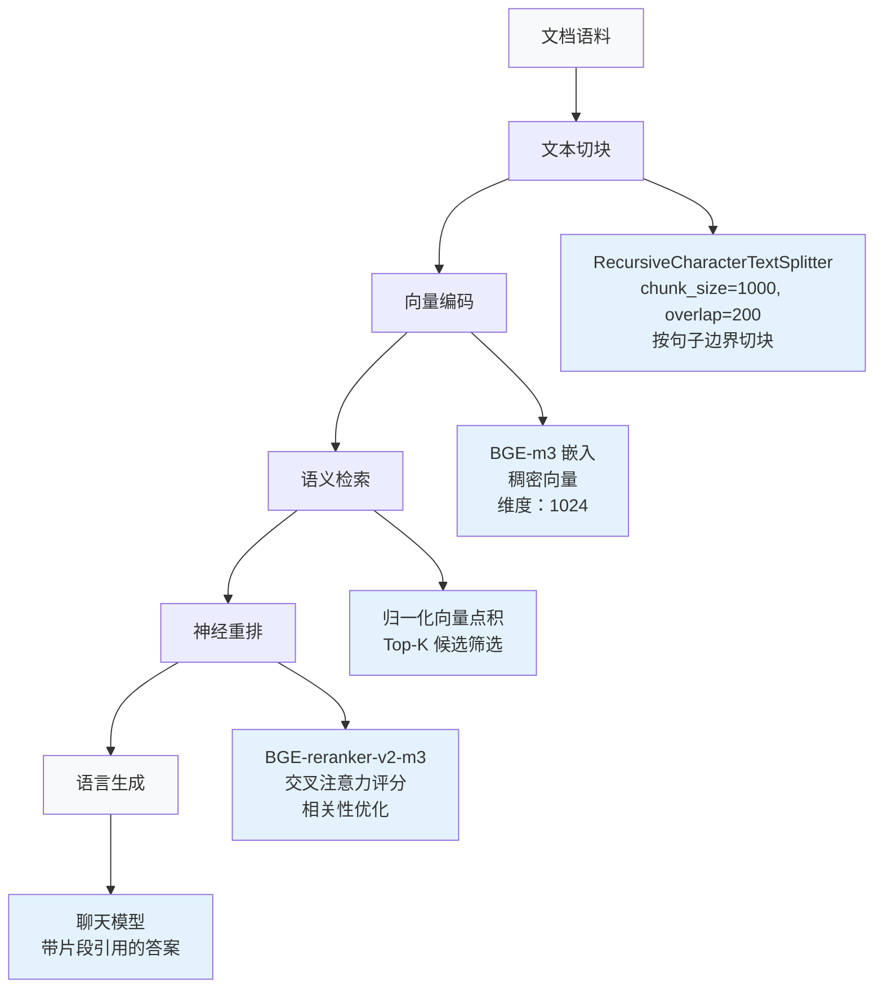

# 检索与重排

本课要用同一个问题说明：重排改变了哪些可用证据，以及这些证据是否足以支撑回答。起点是已提供分块、嵌入、召回和生成的参考程序，学员负责固定问题、预测筛选结果，再核对排序与引用。

默认实操入口是 [单文件实验](reranker/README.md)，使用 DashScope 完成向量化、重排和生成。设置 `DASHSCOPE_API_KEY` 后，从仓库根目录运行：

```bash
python -m chapter6.shared.rag reranker --live
```

先对照召回候选、重排入选片段和最终引用。没有密钥时，`python -m chapter6.shared.rag reranker` 可查看历史回放；回放使用较早的模型配置。

先用默认问题“页面正文未变，但从项目甲迁到项目乙，原项目和新项目分别应收到什么通知？”核对 `migration-events` 与 `regression` 原文中的迁出、迁入及重复投递规则。打开 `reranker/lab.py`，固定 `QUESTION`、语料和 `RETRIEVE_K`，只把 `KEEP_K` 从 3 改为 1，再从重排单元开始执行。运行前预测会保留哪条证据，运行后记录 `CANDIDATES`、`SELECTED` 和答案引用，指出实际丢失或保留的信息。两种评分分别用于各自阶段的排序。

验收时逐条检查“甲收到迁出、乙收到迁入”的结论能否对应入选原文，并解释只保留一个片段后证据是否仍完整。若第一阶段没有召回必需原文，应回到召回阶段定位问题。默认语料是合成教学数据；无 `--live` 的运行器只读取固定回放，不能用它验证本次参数修改。在线实验保留两轮不同文件名的日志，改回 `KEEP_K = 3` 即可恢复起点。完整字段和日志位置见[单文件说明](reranker/README.md)。

用本地 BGE-m3 召回、BGE-reranker 重排，再由 DeepSeek 生成答案时，按[模型配置](../../README-DEEPSEEK.md)设置聊天模型。从仓库根目录运行：

```bash
python -m pip install -r chapter6/reranking/requirements.txt
python chapter6/reranking/rag_pipeline.py --question '如何在 Python 中定义函数？' --retrieve 10 --keep 3
```

首次运行会下载两个模型，权重合计约 4.5 GB。先看召回顺序，再用片段 ID 核对重排变化。读一遍入选原文，对照最终回答中的引用编号。把 `--keep` 改成 1，用同一个问题再跑一轮，检查少了哪些证据。

独立的 DeepSeek Flash 重排实验通过 `deepseek_workshop.py` 运行。三条路径的重排模型不同，对照结果时请记录实际运行的路径。

保留本课问题、入选原文和最终引用。进入工程实战后，复用这份记录的字段，分别观察知识库维护和 MCP 接入怎样改变可用证据。继续完成去重、反馈、语种分库、图谱迭代与 MCP 接入，见 [检索与知识练习目录](../README.md)。逐题调整召回量、最终入选量和问题，可继续运行 `python chapter6/reranking/deepseek_workshop.py --generate`。

## 工程任务

知识库返回了相关片段，答案却遗漏关键规则。你要分清是候选没被召回、重排丢失，还是生成误读。

在 [reranker/lab.py](reranker/lab.py) 中，固定问题、语料与所有模型，只调整进入答案上下文的 KEEP_K。

定位第一处丢失证据的环节，再决定应该增加候选、调整重排还是修改生成上下文。

## 技术概览

<a id="key-technical-competencies"></a>

### 需要掌握的技术能力

- **文档处理流水线**：使用 LangChain 的 RecursiveCharacterTextSplitter 实现文本切块
- **稠密嵌入**：使用 BGE-m3 将文档和查询编码为稠密向量
- **神经重排**：接入 BGE-reranker-v2-m3，改善候选片段的排序精度
- **基于上下文生成**：实现检索增强的语言模型推理
- **系统架构**：设计可扩展的端到端 RAG 流水线

<a id="system-architecture-and-components"></a>

## 系统架构与组成

<a id="1-core-technology-stack"></a>

### 1. 核心技术栈

- **BGE-m3（BAAI/bge-m3）**：本实现使用归一化稠密向量。模型还支持稀疏表示与多向量表示，可用于后续实验。
- **BGE-reranker-v2-m3**：通过交叉注意力机制评估候选相关性的神经重排模型
- **Chat Completions API**：依据重排后入选的片段生成答案
- **LangChain 框架**：提供文档处理与文本切块工具

<a id="2-pipeline-architecture"></a>

### 2. 流水线架构



<a id="3-experimental-setup"></a>

### 3. 实验设置

- **文档语料**：将 8 份 Python 技术文档切成 11 个语义连贯的片段
- **问题集合**：围绕 Python 数据类型、函数定义，以及 Pandas 与 NumPy 的区别提出 3 个问题
- **评估指标**：检索 Precision@K、重排效果和生成质量

<a id="technical-deep-dive"></a>

## 技术详解

<a id="1-advanced-document-segmentation"></a>

### 1. 文档切块

```python
text_splitter = RecursiveCharacterTextSplitter(
    chunk_size=1000,     # Optimal semantic chunk size
    chunk_overlap=200,   # Contextual overlap for coherence
    separators=["\n\n", "\n", "。", "！", "？"]  # Multi-lingual delimiter support
)
```

<a id="2-two-stage-retrieval-optimization"></a>

### 2. 两阶段检索优化

- **候选召回**：使用 BGE-m3 稠密嵌入，召回数量可配置
- **精排筛选**：根据 BGE-reranker 的交叉注意力评分筛选，保留数量可配置

<a id="3-context-aware-language-generation"></a>

### 3. 基于上下文的语言生成

- 将片段组织成带来源信息的上下文
- 逐条对照引用和对应片段，核验回答中的结论
- 结合多个来源的证据进行推理

<a id="performance-observation"></a>

## 性能观察

记录本轮运行的召回片段数、重排片段数、总耗时和生成耗时。阅读入选片段，核对答案质量。

<a id="critical-learning-focus-areas"></a>

## 学习重点

<a id="1-rag-pipeline-component-analysis"></a>

### 1. RAG 流水线组成分析

- **检索阶段**：语义检索算法与向量空间优化
- **增强阶段**：上下文工程与相关性筛选机制
- **生成阶段**：依据检索增强上下文进行条件语言建模

<a id="2-model-architecture-selection-criteria"></a>

### 2. 模型架构选择依据

- **BGE-m3 与其他嵌入模型**：比较多语种能力和语义表示质量
- **BGE-reranker 与基线排序**：比较神经重排效果与计算开销
- **模型组合设计**：通过合理组合模型改善系统表现

<a id="3-production-engineering-considerations"></a>

### 3. 工程实践中的考虑

- **文档预处理的影响**：分析切块质量与检索效果的关系
- **超参数调整**：关注 chunk_size、top_k 和 temperature 等关键参数
- **系统监测**：建立性能评估方法与优化策略

<a id="-customization--extension"></a>

## 🛠️ 定制与扩展

<a id="1-replace-document-sources"></a>

### 1. 替换文档来源

```python
# Replace with your documents in load_sample_documents()
documents = [
    Document(id="doc_001", title="Your Document Title", content="Document content...")
]
```

<a id="2-adjust-retrieval-parameters"></a>

### 2. 调整检索参数

```python
result = rag_pipeline.query(
    question="Your question",
    retrieval_top_k=20,  # Adjust retrieval count
    rerank_top_k=5       # Adjust reranking count
)
```

<a id="3-custom-segmentation-strategy"></a>

### 3. 定制切块策略

```python
text_splitter = RecursiveCharacterTextSplitter(
    chunk_size=1500,     # Increase chunk size
    chunk_overlap=300,   # Increase overlap
    separators=["。", "\n", " "]  # Custom separators
)
```

<a id="-further-reading"></a>

## 📚 延伸阅读

- [BGE-m3 模型资料](https://huggingface.co/BAAI/bge-m3)
- [BGE-reranker 技术文档](https://huggingface.co/BAAI/bge-reranker-v2-m3)
- [LangChain 文档切块指南](https://python.langchain.com/docs/modules/data_connection/document_transformers/)
- [RAG 系统设计实践](https://docs.llamaindex.ai/en/stable/getting_started/concepts.html)

<a id="technical-mastery-assessment"></a>

## 技术掌握情况自查

<a id="acquired-competencies"></a>

### 应掌握的能力

1. **端到端 RAG 架构**：实现从文档入库到答案生成的完整流水线
2. **嵌入与重排系统**：部署 BGE 系列模型，完成语义表示与神经重排
3. **文档工程**：构建保持语义的文本切块与预处理流水线
4. **多模型集成**：在工程环境中组织不同 AI 组件协作
5. **性能优化**：掌握系统评估方法与效率改进策略

<a id="recommended-learning-progression"></a>

### 后续学习方向

- **知识图谱练习**：构建与证据核对
- **NL2SQL 练习**：企业场景中的自然语言转 SQL
- **进阶主题**：多模态 RAG 架构、自主 Agent 系统设计

---

<a id="next-steps"></a>

## 后续学习

## 在自己的项目中使用

在自己的固定问题集中标出每题需要的原文，分别检查召回候选与最终上下文。将相关文档被遗漏的案例与排序错误分开，再把策略接回[向量问答](../vector_qa/README.md)的批量实验；两者的数据格式与检索实现需要自行适配。

[主题目录](../README.md) · [课程首页](../../README.md)
