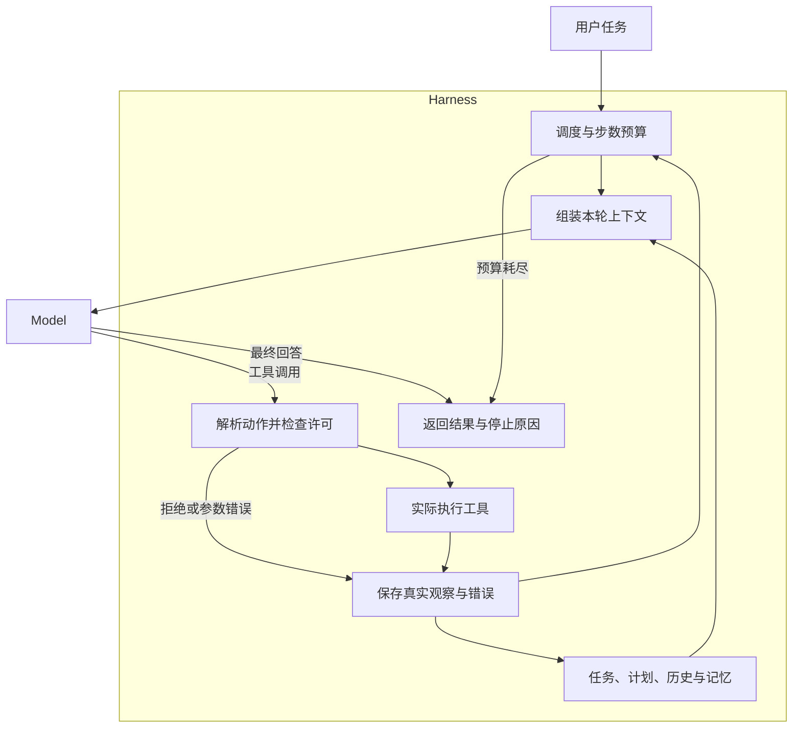

# 智能体的认知架构

组织模型、上下文、工具和状态，让任务能够执行、停止和接续。理解 **Agent = Model + Harness**，并学习怎样判断系统表现来自哪一部分。

先掌握[工具循环](../chapter8/manual_tool_loop/README.md)与[会话状态](../chapter8/conversation_memory/README.md)。下面按系统面临的问题组织实验。

## 一次任务怎样经过系统

下面按[随课 MCP Harness](mcp_harness/README.md)的职责画出循环。Model 接收本轮输入并给出回答或动作；Harness 管理调度、上下文、许可、执行和状态。



在本例中，MCP Prompt 读取 Resources 后端生成上下文，MCP Tools 执行动作并写回观察。消息中出现“完成”只代表一种模型输出；任务是否达标，要继续核对文件、计算或外部查询的实际结果。

## 设计对照：改变了什么，怎样判断

| 问题 | 对照方式 | 看什么，怎样作出判断 |
| --- | --- | --- |
| 稳定内容怎样复用 | 固定角色与工具，把每轮变化的字段从开头移到后面 | 比较首个变化位置，再读取后端缓存计数；前缀相同只说明可复用条件，没有计数时不推断实际收益 |
| 工具怎样随状态受限 | 保持工具定义，改变执行入口的许可规则 | 同一个动作在不同状态下实际允许或拒绝；提示中说明限制后，执行器仍需检查 |
| 长观察怎样保存 | 将原文保存在文件中，只把摘要与引用放入当前输入 | 从引用找回原文，检查摘要是否丢失条件；外部存储增加后，每次模型输入仍受窗口限制 |
| 失败怎样影响后续行动 | 比较隐藏错误与保留错误轨迹的决策输入 | 下一轮能否看到真实失败，是否更正参数、换策略或在预算内停止 |
| 能力来自哪里 | A/B 固定模型改变只读策略；A/C 固定 Harness 更换模型 | 使用相同任务副本与独立检查，比较执行结果、权限拒绝和实际调用轨迹 |

例如，构造请求时比较下面两种组织方式；它们表达相同的信息，但动态字段所在的位置不同：

```python
# 时间变化发生在可复用指令之前。
early_dynamic = f"时间：{now}\n{instructions}\n问题：{question}"

# 固定指令在前，本轮时间与问题放在后面。
stable_prefix = f"{instructions}\n时间：{now}\n问题：{question}"
```

在[缓存实验](prefix_cache/README.md)中核对实际前缀与服务用量；在[工具遮罩实验](tool_masking/README.md)中独立检查动作许可。缓存、权限与状态管理分别解决不同问题，需要各自的运行证据。

## 评估结果与代价

先判断任务是否完成，再解释采用某项机制的开销。对同一组输入比较，保留模型、语料、工具与策略配置：

| 维度 | 记录依据 | 判断边界 |
| --- | --- | --- |
| 任务正确性 | 计算参考值、代码测试、引用原文或实际服务结果 | 最终文字流畅、模型自评或测试文件存在，不能单独证明任务完成 |
| 执行过程 | 实际参数、工具结果、拒绝原因与错误轨迹 | 模型声称调用工具，需要与执行记录对应 |
| 恢复能力 | 新进程加载的状态，以及继续任务后的实际行为 | 文件写入成功与恢复后仍能正确工作分别检查 |
| 调用与用量 | 逻辑调用、框架轮次、服务返回的 Token 与缓存计数 | 三者单位不同；模型回复数不等于计费请求数，未报告字段不自行补值 |
| 延迟与成本 | 同一运行条件下的耗时，以及服务价格与实际用量 | 初始化、索引和任务执行分开比较；成本依提供方计费口径计算 |

[三组对照](mcp_harness/README.md#model-harness-comparison)提供相同起点的代码副本与独立行为检查，适合开始比较 Model 和 Harness。缓存、记忆和恢复练习各有对应观察点；在单个任务上有效后，再用未参与调整的问题检查是否仍然成立。

## 怎样接入外部能力

| 练习 | 要做出的判断 |
| --- | --- |
| [MCP 工具发现与调用](mcp_tools/README.md) | 服务暴露了什么工具，客户端实际传入什么参数？ |
| [飞书远程 MCP](feishu_mcp/README.md) | 凭证、权限、协议连接与文档搜索分别是否成功？ |
| [CLI Skill 与扫码授权](cli_skills/README.md) | 本机授权与命令怎样复用，怎样封装为可调用技能？ |
| [Pi SDK 与技能加载](pi_skills/README.md) | SDK 管理了什么，加载技能后实际读取和执行发生了什么变化？ |
| [检索服务接入 Harness](rag_mcp/README.md) | 新旧语料、工具返回与最终引用是否一致？ |

MCP 与 CLI 分别运行和核对，再用相同账号与关键词比较接入方式。认证体验取决于具体服务与实现，协议与扫码流程分别理解。

## 怎样控制持续执行

| 练习 | 要做出的判断 |
| --- | --- |
| [顺序工作流](sequential_planning/README.md) | 固定步骤能否保留原始约束，何时需要动态决策？ |
| [面向缓存的提示设计](prefix_cache/README.md) | 哪些输入可以稳定复用，服务是否实际报告缓存收益？ |
| [工具遮罩](tool_masking/README.md) | 当前状态允许什么动作，限制是否由程序真正执行？ |
| [目标复述与任务管理](task_recitation/README.md) | 长任务是否保留目标、约束和未完成事项？ |
| [错误保留与失败学习](error_recovery/README.md) | 失败怎样影响下一次决策，何时应停止重试？ |
| [反思与改进](reflection/README.md) | 评审依据是什么，改写和记忆是否解决同一类问题？ |

先在各实验中观察单项机制，再选择与任务失败有关的机制加入自己的实现。增加记忆、规划或反思后，在同一任务上重新核对结果与额外开销。

## 组合成一个完整 Harness

[用 MCP 实现 Agent Loop 与 Harness](mcp_harness/README.md)提供终端编程任务：Prompt 从 Resources 后端组装上下文，Tools 执行动作并保存观察，循环管理批准、预算和恢复。

先运行一个完整任务，再拆开检查上下文和工具调用。最后通过[模型与运行策略对照](mcp_harness/README.md#model-harness-comparison)分别改变 Model 与 Harness，用文件、测试和状态解释结果。

迁移到自己的任务时，先定义成功条件和工具边界，再决定如何保存状态、处理失败和恢复。只有拿到实际执行结果，才能判断新增机制是否有用。

## 参考阅读

- [CoALA：语言智能体的认知架构](https://arxiv.org/abs/2309.02427)：用记忆、动作和决策框架梳理各项机制，回到自己的 Harness 标出对应实现。
- [构建 Manus 的上下文工程经验](https://manus.im/blog/Context-Engineering-for-AI-Agents-Lessons-from-Building-Manus)：对照缓存、工具遮罩、文件系统、目标复述和错误保留实验，区分上下文设计与模型参数更新。
- [Reflexion：通过语言反馈改进智能体](https://arxiv.org/abs/2303.11366)：思考反馈何时应进入记忆，以及怎样在后续任务中检验它的作用。
- [MCP 协议规范（2025-11-25）](https://modelcontextprotocol.io/specification/2025-11-25)：从 Tools、Resources 与 Prompts 回看完整循环，区分协议能力与 Harness 的调度职责。

[学习地图](../README.md#学习地图) · [模型配置](../README-DEEPSEEK.md#setup)
