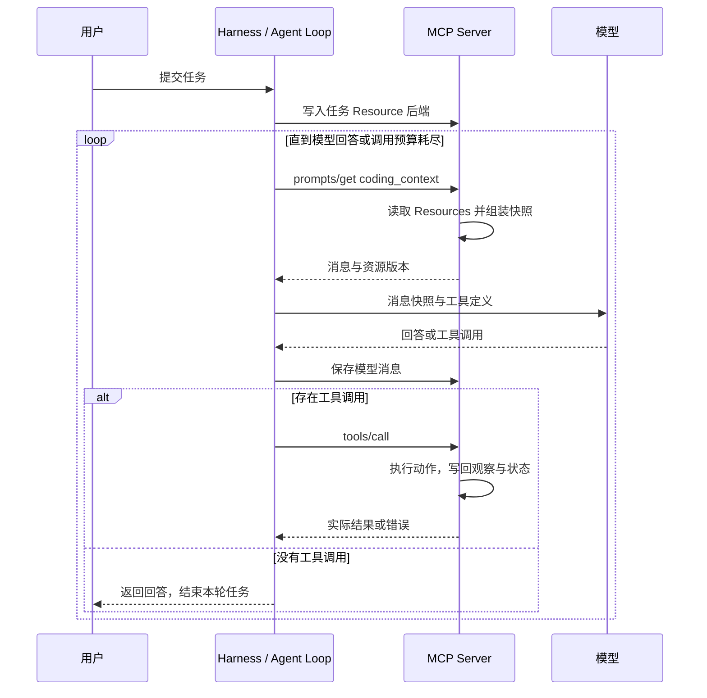
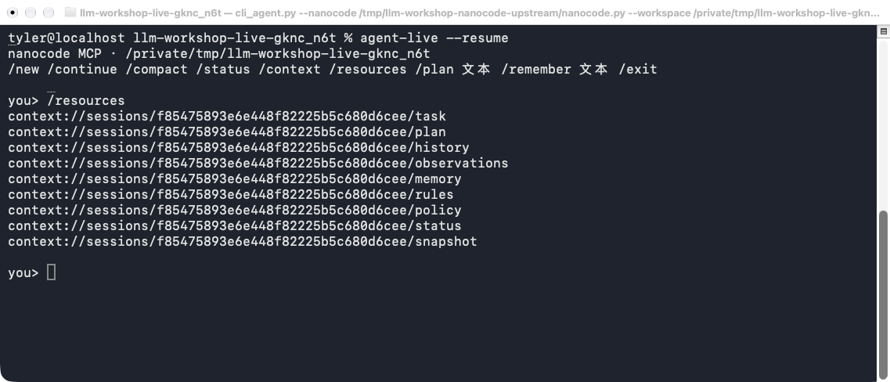
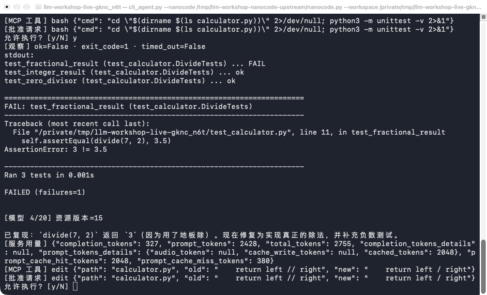
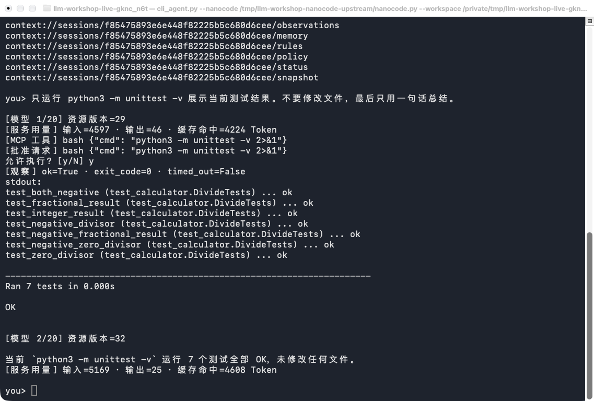
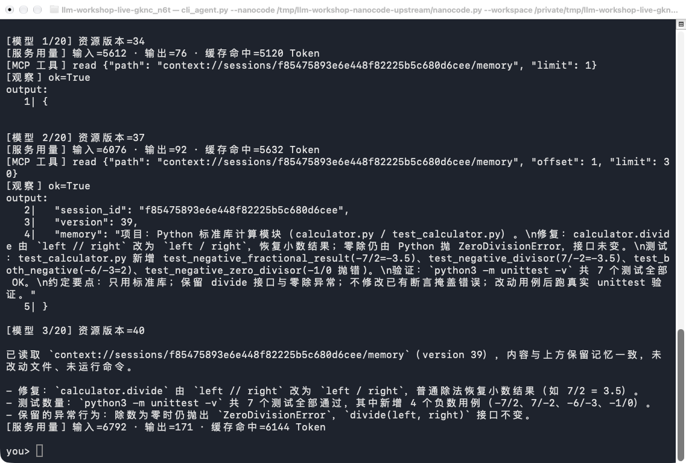

# 用 MCP 实现 Agent Loop 与 Harness

通过一个终端编程任务，拆开观察 Harness 的核心：**Agent Loop 怎样获取上下文、调用模型、通过 MCP 执行动作、保存观察，再进入下一轮。** 代码、目标样例和操作截图位于当前目录。

Harness 是驱动模型持续工作的运行程序。本例将动态状态放在 MCP Resources 后端，由 MCP Prompt 组装输入，具体动作通过 MCP Tools 执行；循环本身负责调度、消息转换、批准和结束条件。Model 是可替换的推理组件，MCP、CLI 和状态后端共同参与本课的 Harness 实现。示例文件工具借用 [nanocode](https://github.com/1rgs/nanocode) 的实现。

## 工程任务

编程 Agent 的最终回答不能证明修复成功，模型能力也不能替代写入权限。

在 [compare_runs.py](compare_runs.py) 中，运行本课三组对照：A/B 固定模型改变只读策略，A/C 固定 Harness 更换模型。

对照实际代码、测试与新会话状态，解释模型变化和只读策略分别影响了什么。

## 一次 Agent Loop 包含什么

| 循环中的动作 | Harness 的实现 | MCP 在这里做什么 |
| --- | --- | --- |
| 接收用户任务 | 保存任务，再开始循环 | 控制工具写入资源后端 |
| 获取本轮上下文 | 取得服务端生成的消息快照 | Prompt 读取 Resources 中的任务、计划、历史和记忆 |
| 模型推理 | 发送消息与工具定义 | 模型接口适配由 Harness 完成 |
| 执行动作 | 解析工具调用，收集批准结果 | `tools/call` 执行工具并返回真实观察 |
| 进入下一轮 | 重新获取上下文，再调用模型 | 观察和消息已写回同一资源后端 |
| 停止或接续 | 返回回答、限制预算、恢复会话 | 资源保留任务与执行状态，支持新进程恢复 |



`CodingAgent.turn` 的关键控制流可简化为下面几步。对照实际源码，找到消息写入、版本检查、工具执行和停止的位置：

```python
await self.event("begin", {"task": task})
for step in range(self.args.max_steps):
    packet = await self.context()             # MCP Prompt 从资源后端组装输入
    reply = await self.complete(packet["messages"], self.tools)
    await self.event("assistant", {
        "message": reply.model_dump(exclude_none=True)
    }, packet["version"])
    if not reply.tool_calls:
        return                               # 控制权交还用户
    await self.pending()                     # MCP Tools 执行，观察写回资源
await self.event("budget", {})
```

上面是省略输出显示和恢复处理的流程示意。模型返回回答说明这一轮循环结束，业务目标是否完成仍要核对实际文件和测试。

## 先运行一个完整循环

使用 macOS 或 Linux、Python 3.11 或 3.12 和课程虚拟环境。MCP 服务使用本地 stdio，由 CLI 自动启动，不需要额外 MCP 凭证。按[模型配置](../../README-DEEPSEEK.md#setup)设置 `OPENAI_BASE_URL`、`OPENAI_MODEL`、`OPENAI_API_KEY`，选择支持工具调用的聊天模型。

从仓库根目录准备工具实现和独立目标项目：

```bash
python -m pip install -r chapter9/mcp_harness/requirements.txt
NANOCODE_DIR=$(mktemp -d)
git clone https://github.com/1rgs/nanocode.git "$NANOCODE_DIR"
git -C "$NANOCODE_DIR" checkout --detach b009d3dbedf14795a5c10804a5455386563f4b5b
LAB_DIR=$(mktemp -d)
cp chapter9/mcp_harness/example_project/*.py chapter9/mcp_harness/example_project/AGENTS.md "$LAB_DIR/"
python chapter9/mcp_harness/cli_agent.py --nanocode "$NANOCODE_DIR/nanocode.py" --workspace "$LAB_DIR"
```

[example_project](example_project/README.md) 是 Agent 要处理的代码，包含故意保留的小数除法缺陷；Harness 的客户端和服务端位于本课目录。修复针对 `$LAB_DIR` 中的副本。

在 `you>` 后输入：

```text
检查项目，先更新计划，再运行测试，修复普通除法的小数结果错误。保留零除异常，补充负数测试，重跑测试，最后更新计划和记忆。
```

先独立算出 `7 / 2`，再观察模型怎样选择读取、测试与编辑工具。写文件或运行终端命令前核对参数，输入 `y` 批准。`--yes` 自动批准本次运行；终端使用本机权限，工作目录不是安全沙箱。

沿一次失败追踪：测试命令 → 退出码和错误 → 下一轮输入 → 源码编辑 → 重跑测试。核对真实代码差异和测试输出，最终回答不能代替这些结果。

<a id="model-harness-comparison"></a>

## 固定模型改 Harness，固定 Harness 换模型

先用同一个起点预测三组结果。A/B 保持模型、任务、工具实现与预算一致，只改变 Harness 的只读策略；A/C 保持 Harness 一致，只更换模型。只读组的动作会受服务端守卫约束，更强的模型也不能代替程序获得写入权限。

| 组别 | Model | Harness | 要解释的差异 |
| --- | --- | --- | --- |
| A | 当前配置模型 | 允许按批准策略编辑和执行命令 | 能否依据真实测试失败完成修复 |
| B | 与 A 相同 | 只读，其他设置与 A 相同 | 写入为何被拒绝，模型怎样报告限制 |
| C | 同一服务内另一兼容模型 | 与 A 相同 | 动作选择、回复次数与修复结果是否不同 |

模型都应支持工具调用。沿用课程 `OPENAI_*` 配置，把 `COMPARE_MODEL` 设置为该服务内另一个真实模型 ID；保持服务地址、显式调用参数、工具、任务和预算不变：

```bash
# 先设置 COMPARE_MODEL；其值为你所用服务的另一个模型 ID。
COMPARE_DIR=$(mktemp -d)
python chapter9/mcp_harness/compare_runs.py \
  --nanocode "$NANOCODE_DIR/nanocode.py" \
  --models "$OPENAI_MODEL" "$COMPARE_MODEL" \
  --max-steps 12 --out "$COMPARE_DIR"
```

每组都从随课文件创建新的目标副本和空白会话，沿用同一批准方式；默认逐次确认，加 `--yes` 才会统一自动批准。终端显示实际 Model 和 Harness 策略。程序在目标工作区之外运行同一份小数、负数、整数及零除检查，分别核验修改前后行为；修改随课测试不会改变这份检查。A/B 是能力边界对照，不以只读组修复成功为目标。

打开本轮 `comparison-*/comparison.json`、各组代码副本及 `.agent/context.json`，沿“本轮输入 → 模型回复 → 实际工具观察 → 文件变化 → 独立核验”解释结果。模型回复次数只统计成功写入的回复，不是计费请求总数。程序沿用服务默认采样设置，并在记录中注明，模型采样波动仍需通过多次独立运行判断。独立检查覆盖运算行为，新增负数测试是否写入仍要查看各组测试文件。模型提前给出最终回答、预算耗尽、工具拒绝与任务真正通过检查要分开说明；一次运行不预设 A 或 C 更好。若服务调用失败，先处理环境问题再建立对照，不能归因于模型能力。

更换模型会使用全新会话；同一个会话中的旧模型回复不能混入新模型起点。对更细的 Harness 机制，继续使用下面的 Resource、工具与恢复练习，每轮仍只改变一项。

## 拆开看：循环调用了哪些 MCP 接口

交互中输入 `/mcp`，或在退出后运行不需要模型密钥的发现入口：

```bash
python chapter9/mcp_harness/cli_agent.py --nanocode "$NANOCODE_DIR/nanocode.py"   --workspace "$LAB_DIR" --resume --list-capabilities
```

| MCP 方法 | 在 Agent Loop 中的用途 |
| --- | --- |
| `tools/list` | 发现动作名称、描述和参数，转换为模型可用的工具定义 |
| `resources/list`、`resources/templates/list` | 发现状态数据与动态 URI 模板 |
| `resources/read` | 读取任务、计划、历史、观察和记忆 |
| `prompts/list`、`prompts/get` | 发现上下文入口，生成本轮消息快照 |
| `tools/call` | 执行动作、更新资源后端、写入消息与观察 |

本例通过动态模板提供会话资源，因此 `resources/list` 可以为空；应同时查看资源模板。工具列表包含六个示例动作、`update_context` 和 Harness 控制入口 `session_event`。路由字段和批准结果由 Harness 填充，模型不能自行选择其他会话或批准操作。

## 拆开看：上下文怎样进入下一轮

同一会话中输入：

```text
/resources
/resource plan
/plan 先运行测试，再修复并核对零除异常。
/resource plan
/context
```

`/resource plan` 实际调用 `resources/read`；`/plan` 通过控制工具更新资源后端；`/context` 调用 `prompts/get coding_context`。固定任务和工具，只修改计划 Resource，预测新上下文的变化位置，再核对两次读取的内容与版本。

任务、计划、历史、观察与记忆的唯一状态来源是 MCP Server 的资源后端。CLI 只保存连接、会话 ID 和本轮临时数据，不维护另一份消息历史。

| Resource URI | 内容 |
| --- | --- |
| `context://sessions/{id}/task` | 当前用户任务 |
| `context://sessions/{id}/plan` | 计划与进度 |
| `context://sessions/{id}/history` | 完整会话及配对的工具消息 |
| `context://sessions/{id}/observations` | 实际执行结果，包括完整错误和输出 |
| `context://sessions/{id}/memory` | 保留的事实、经验或压缩摘要 |
| `context://sessions/{id}/rules` | 创建会话时读取的根 `AGENTS.md` |
| `context://sessions/{id}/policy` | 当前读写、提醒和输出策略 |
| `context://sessions/{id}/status` | 状态、版本与待处理工具调用 |
| `context://sessions/{id}/snapshot` | 当前模型消息快照 |
| `context://sessions/{id}/artifacts/{key}` | 完整长观察 |


Resources 标准接口负责读取。写入由 `session_event`、`update_context(plan, memory)` 和执行工具的服务端保存逻辑完成，更新的是同一后端；没有定义额外的 `resources/write`。

MCP Prompt 的标准消息角色是 `user` 或 `assistant`。本例返回一个嵌入 Resource，内容是原生模型消息数组的 JSON 快照；CLI 显式解析，保留 `system`、`assistant.tool_calls` 和 `tool` 的配对关系，再传给模型。

学员修改服务端的 `coding_context`、`snapshot` 或 `reminder`，保持资源内容和任务一致，对照不同编排如何影响下一轮输入。修改代码后重启程序。快照版本会在模型结果写入时检查，避免默默使用已过期的上下文。

## 拆开看：工具结果怎样改变后续决策

模型选择 `read / write / edit / glob / grep / bash` 执行动作，选择 `update_context` 更新计划和记忆。Harness 将选择转换为 MCP 调用，服务端执行后同时返回观察并写入资源后端。

让 Agent 明确调用 `read` 读取不存在的 `not-exist.py`，报告错误并保持文件不变。检查实际错误是否出现在 observations Resource，以及下一轮模型有没有依据错误调整参数。`--hide-errors` 用于比较具体失败反馈被隐藏时的行为；完整观察仍保留，它不是权限开关。

把 `--max-output` 调小到 `300`，观察长结果中的 `truncated`、`preview` 和 `artifact` URI。完整观察作为资源保存，`json_chunks` 的 `chunks` 拼接后可还原原结果。让 Agent 用 `read` 以较小 `limit` 按行恢复，不能把片段当完整结果。

使用 `--read-only` 进行准入对照：工具定义保持完整，服务端拒绝代码编辑与终端执行，但仍保存任务、计划和观察。

## 拆开看：循环怎样停止和恢复

在新目标副本上固定任务，只把 `--max-steps` 调为 `2`。观察循环因预算停止后 `/status` 中的状态，再用 `/continue` 接续。说明任务尚未完成与模型已返回回答的区别。

退出 CLI 后，用同一工作区恢复：

```bash
python chapter9/mcp_harness/cli_agent.py --nanocode "$NANOCODE_DIR/nanocode.py" --workspace "$LAB_DIR" --resume
```

比较会话 ID，再读取原计划和记忆。新进程从资源后端接续，而不是靠模型跨请求记住工作。`/compact` 将摘要写入 memory，缩短工作上下文，同时保留完整 history 与 observations；检查摘要遗漏时能否读回原始观察。

已完成调用重试会返回原观察；执行中退出时，恢复会提示结果未知，应先检查实际文件再决定动作。同一工作区一次运行一个服务端。

## 代码入口与动手范围

| 文件 | 对应职责 |
| --- | --- |
| [cli_agent.py](cli_agent.py) | `turn` 驱动循环，`context` 获取 Prompt，`pending` 调用 MCP Tools |
| [context_server.py](context_server.py) | 资源读写、Prompt 组装、消息与观察保存、版本检查 |
| [coding_tools.py](coding_tools.py) | 实际文件和终端操作、路径检查与准入 |
| [example_project](example_project/README.md) | Agent 要修复的独立代码项目 |

先追踪原版的一轮，再分别改变计划资源、Prompt 编排、准入或错误反馈；每次固定其他条件，只修改一项。用实际请求、资源内容、工具参数和产物说明差异，不通过修改测试预期掩盖失败。

`/new` 创建新资源会话，保留代码；新临时目录才能恢复带缺陷的起点。`/status`、`/resources`、`/context` 查看状态与输入；`/remember 内容` 写入记忆；`/exit` 退出。服务端运行数据位于工作区 `.agent/context.json`，无需提交。

完成后应能指出：一轮模型调用从何处获得输入；模型的动作如何变成 MCP 调用；观察写到哪里；下一轮如何读回；循环何时继续、何时结束。MCP 工具发现与远程接入的独立练习分别见本部分的 MCP 工具发现与飞书远程 MCP 练习。

## 操作画面

以下是该 Harness 使用 DeepSeek Flash 处理随课项目的实际终端画面。`agent-live` 是本机启动命令的缩写，复现时使用上面的完整命令。界面中的实现名称和模型输出可能随版本与运行变化。

查看资源地址并恢复会话：



复现失败、核对编辑参数并批准：



通过 MCP 工具重跑测试：



读取 memory Resource，依据保存内容继续工作：



## 在自己的项目中使用

选择一个有独立测试的小型代码任务，明确目标、允许动作与停止条件，再替换示例工作区。先用固定模型建立起点，再按失败原因调整上下文、工具或预算；改变模型时使用新的任务副本与会话。结合[错误恢复](../error_recovery/README.md)与[工具遮罩](../tool_masking/README.md)，用实际执行检验新增机制。

[主题目录](../README.md) · [MCP 工具发现与调用](../mcp_tools/README.md)
